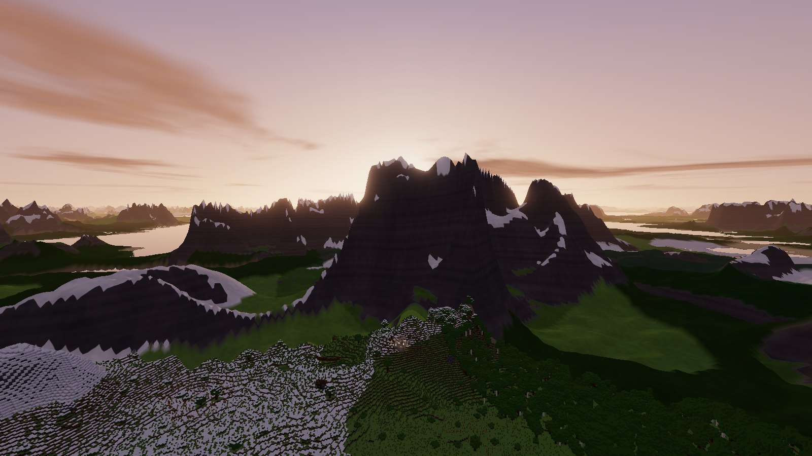
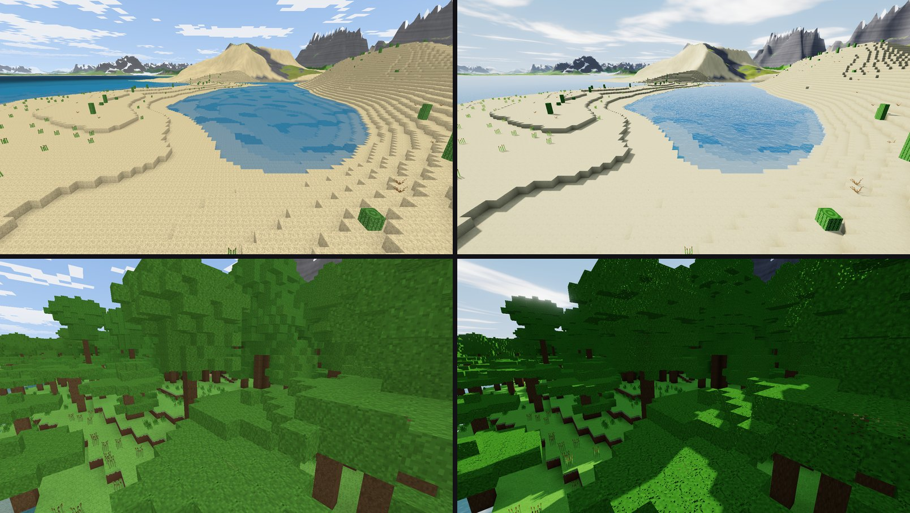
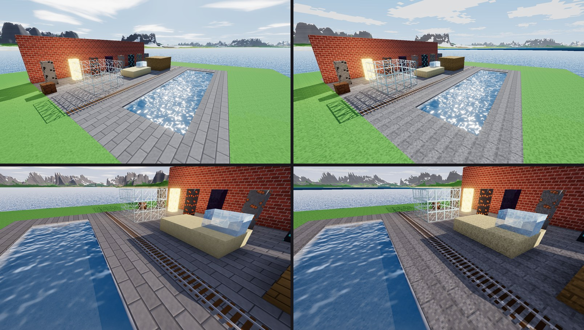
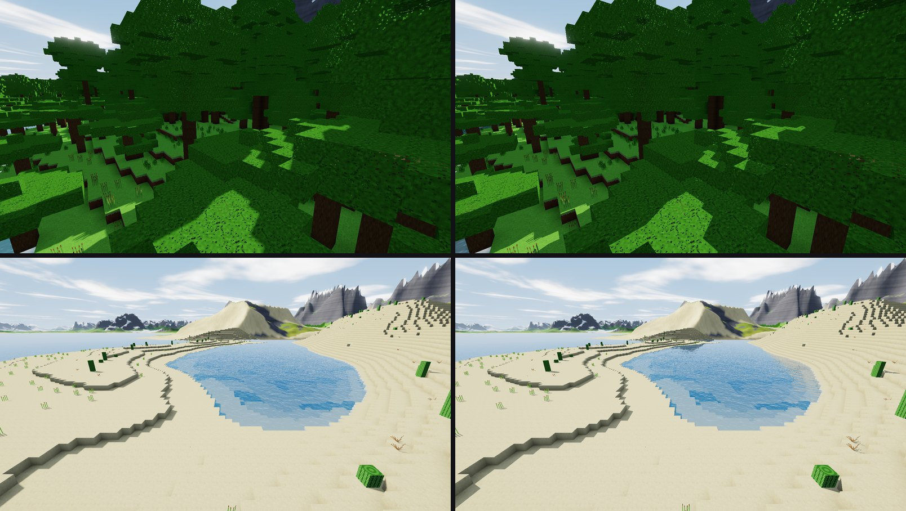
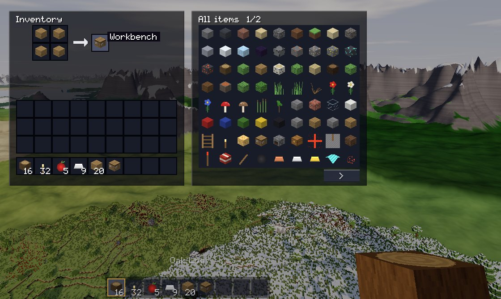

# Zenith

An original voxel sandbox game in Rust: a world that runs to the horizon, made from nothing but a seed.



Zenith was designed after studying [Horizon](https://github.com/horizon-rust/horizon), a Rust rewrite of Minecraft.
**It is not a port and it is not compatible with Minecraft.** It has no Mojang code, assets or data, and it cannot open
Minecraft worlds or join Minecraft servers. It also has far less content than Horizon. What it offers instead is a set
of engineering choices that a game free of compatibility can make. [docs/REVERSE_ENGINEERING.md](docs/REVERSE_ENGINEERING.md)
explains each one, and what it costs.

## Build and run

You need [rustup](https://rustup.rs) and a GPU with Vulkan, DirectX 12 or Metal.

```bash
cargo run --release -p zenith-client
```

**On Windows without Visual Studio**, use the GNU toolchain, which needs nothing else installed:

```bash
rustup toolchain install stable-x86_64-pc-windows-gnu --profile minimal
```

```bash
rustup override set stable-x86_64-pc-windows-gnu
```

It has only been run on Windows 11 with an NVIDIA GPU. Nothing is meant to be Windows-only, but **Linux and macOS are
untested**.

### Controls

| | |
| --- | --- |
| Walk, jump, sneak, sprint | W A S D, Space, Shift, Ctrl |
| Break and hit, place and use | Left mouse, right mouse |
| Eat, draw a bow, raise a shield | Hold the right mouse |
| Get into a boat or cart, and out | Right mouse on it, Shift |
| Inventory, chat, command, drop | E, T, /, Q |
| Hotbar | 1 to 9, or the wheel |
| Fly, in creative | Tap Space twice |
| Hide the HUD, screenshot, debug text, fullscreen | F1, F2, F3, F11 |
| Debug options | F6 |
| Menu | Esc |

**F6** opens the debug options: the info text, a graph of frame times, chunk borders, hitboxes, fog, clouds and full
bright, and buttons to set the time, the weather and the game mode or go back to spawn.

Frames are not held to the display's rate: **Frame cap** in the pause menu turns that on, for a quieter graphics card.

Saves and settings are in your user data folder (on Windows, `%APPDATA%\Zenith`), or wherever `ZENITH_HOME` points.

## What's in it

- **A world**: 15 biomes on continents with oceans, rivers, caves, ores, mountain ranges, ruins and vaults. Far terrain
  reaches the horizon, drawn from the same function the real chunks come from.
- **Survival and creative**: about 90 kinds of block, tools, armour, crafting, furnaces, chests, health and drowning.
- **Hunger**: work makes you hungry. A full food bar heals you, an empty one hurts, and on a low one you cannot sprint.
  Food takes a moment to eat.
- **Farms and beds**: a hoe turns soil, seeds from tall grass grow into grain, faster in watered soil, and grain bakes
  into bread. Sleeping in a bed skips the night, and you wake there when you die.
- **Building**: doors, trapdoors, fences and gates, stairs and slabs, and signs you can write on.
- **Life**: zombies and skeletons that hunt you, and two of the game's own: the Gloomcrawler, which climbs walls to
  reach you, and the Lurker, which waits in dark caves. Sheep, pigs and chickens wander, and when fed they breed and
  their young grow up. Day and night, rain and snow.
- **Fighting**: swords, a bow whose arrows fly further the longer it is drawn, a shield that turns blows from the
  front, and experience levels from what you defeat and from the coal, ember and crystal you dig.
- **Travel**: boats on water, and rails with carts that roll downhill, round corners and up slopes, and booster rails to
  speed them along.
- **Water, fire and fish**: a copper bucket scoops up a spring of water or lava and pours it out again. A fishing rod
  casts a float, and a pull while something bites brings in a perch or a trout. A tinderbox lights fire, which burns
  through wood, wool and leaves and dies on bare ground, and a campfire cooks what is laid on it.
- **Moving parts**: water and lava that flow, sand that falls, TNT, and signal wires with levers, lamps and inverters.
- **Multiplayer**: a dedicated server, and single player is the same server on a thread.
- **Mods**: content packs that add blocks, items and recipes, found and installed from the **Mods** screen, from web
  catalogues, Git repositories or the three examples that come with the game. A server sends them to whoever joins.
- **Two looks**: classic, with big-pixel textures and flat shading, and modern, with sun shadows, bloom and materials
  that catch the light. On a graphics card that traces rays in hardware, either look can be ray traced. See below.
- **Phones**: an Android app, played with a thumb stick and touches. See below.
- **For AI agents**: everything a player can do is a command, on a command line or as an MCP tool. See below.

Every texture is painted by code and every sound is synthesised, so the game has no asset files.

### Two looks

**Look** in the pause menu, or `--look classic` and `--look modern`, chooses how the world is drawn.

- **Classic**, to begin with, is the long-standing look of block games: textures in big hard-edged pixels and a handful
  of colours each, every face shaded by the way it points instead of by the sun, flat colours with no bloom, a layer of
  blocky clouds, a sun and moon made of pixels, and plain see-through water. The textures are the game's own painted
  ones, redrawn at half the resolution.
- **Modern** has the finer textures, sun shadows, bloom, a filmic tone curve, soft clouds and water that mirrors the
  sky. Every block has a material, worked out from its own texture the way ray-traced resource packs give their blocks
  one: brick and stone stand out in relief, wool and sand stay dull, metal in ore and rails glints in the sun, glass,
  ice and obsidian mirror the sky, and only the bright parts of a lamp glow.



Classic is the lighter of the two, with no shadow or bloom passes: about 640 frames a second against 340 at view
distance 16 on the machine it was built on ([benchmarks](docs/BENCHMARKS.md)).

### Ray tracing

On a graphics card that traces rays in hardware, through Vulkan (an NVIDIA RTX card, for one), **Ray tracing** in the
pause menu, or `--ray-tracing`, lights the world with traced rays instead of a shadow map:

- **Shadows** are exact out to 16 chunks, and leaves let the sun through wherever their picture has gaps.
- **Water**, glass, ice and obsidian reflect the land around them, lit and shadowed as it is, and not only the sky.
- **The classic look** keeps its big-pixel pictures, blocky clouds and pixel sun, and is lit like the modern one: sun,
  shadows, materials, glints and bloom, as a ray-traced resource pack would do for the old textures.





On the machine it was built on it costs nothing: tracing replaces the two shadow-map passes, which cost more, so the game
is as fast with it at view distance 16 and faster at 32 ([benchmarks](docs/BENCHMARKS.md)). It uses wgpu's ray queries,
which wgpu still calls experimental, so the game asks for them only from a card that offers them, and
`ZENITH_NO_RAY_TRACING=1` stops it asking at all. Elsewhere the option says it is not available. Each chunk section's
structure is built straight from the vertices the game already draws, so it takes no second copy of the world.



## On Windows and Android

`tools/package-windows.sh` packs the game, the server and the tools into `dist/zenith-VERSION-windows-x64.zip`, which
runs on Windows with nothing else installed.

`tools/build-apk.sh` builds `dist/zenith-VERSION.apk`, one app for Android 8 and later on phones (64-bit ARM) and on the
emulator (x86-64). It needs the Android SDK (build-tools and platform 34), the NDK, a Java runtime and Rust's Android
targets, but not Gradle, as the app is all native code:

```bash
rustup target add aarch64-linux-android x86_64-linux-android
```

The app is signed with a debug key made on the first build, so it installs from the file but is not ready for a store.
On a phone, a stick under the left thumb walks, the rest of the screen looks around, a resting finger breaks what is
there (or eats, draws the bow or raises the shield, with one of those in hand), a tap places or uses, and buttons jump,
sneak, open the inventory and pause. It has been played in the Android emulator, not yet on a phone.

## Mods

The **Mods** screen on the title screen browses sources, installs, updates, and turns mods on and off.

A mod written for Minecraft cannot run here: it is Java code for another game. What such a mod *declares* can be
converted, from its `.jar` or a folder of them:

```bash
cargo run --release -p zenith-ctl -- mods convert path/to/mod.jar
```

Its plain blocks, plants, slabs and stairs become blocks here, coloured from their own pictures; its items become
materials, tools or food by their names; and its recipes come along where everything they need exists here. Nothing its
code does comes with it, so a mod that is all code, such as one that changes how the world is drawn, converts to nothing,
and the report says so. Zenith already draws far terrain to the horizon by itself. The converter has been tried on jars
made for its tests, not yet on a published mod.
[docs/MODS.md](docs/MODS.md) covers playing with them, publishing them, and running them on a server.

### For Minecraft: mc-modkit

Zenith cannot run Minecraft mods, so this is a separate tool, for your own copy of Minecraft: Java Edition. It installs
**Fabric, Quilt, Forge or NeoForge**, and mods from **Modrinth**, or **CurseForge** with an API key. Each installation
it makes has its own mods folder and its own entry in the official launcher:

```bash
cargo run --release -p mc-modkit
```

That asks its way through, step by step. [docs/MODS.md](docs/MODS.md#mc-modkit-for-minecraft-java-edition) has the
commands, and says which parts have been tried against the real services and which have not.

## Playing together

```bash
cargo run --release -p zenith-server -- --world my-world --port 25575
```

Then choose **Join a server** in the game. Try `--help` for the options. The server listens on every network interface
unless given `--bind 127.0.0.1`. **Connections are not encrypted, and a server password travels in the clear**, so keep
it to networks you trust.

## For AI agents and scripts

`zenith-ctl` can play the game. It can start a whole player with no window and no GPU:

```bash
cargo run --release -p zenith-ctl -- play --world my-world --creative
```

From another terminal, each command prints its reply as JSON:

```bash
cargo run --release -p zenith-ctl -- state
```

Or serve every command to an AI client over MCP on stdio:

```bash
cargo run --release -p zenith-ctl -- mcp
```

`zenith --control FILE` lets the same commands drive the real game, including `screenshot`, and simulated keyboard and
mouse (`key`, `type`, `mouse`) for its screens. All of them are listed in [docs/commands.md](docs/commands.md), which is
generated from the one table that also produces the help text, the argument checks and the MCP tools.

## How it's built

```
zenith-core      positions, deterministic maths, noise, palettes, a worker pool
zenith-content   blocks, items, recipes, content packs
zenith-world     terrain from a seed, light, physics, path finding, crash-safe region files
zenith-protocol  every message, one encoding, over memory or TCP
zenith-server    the game itself: fluids, signals, mobs, inventory, commands, saves
zenith-agent     a whole client with no window: session, prediction, autopilot, control socket
zenith-mesh      chunks into triangles, on the CPU
zenith-client    the window: wgpu renderer, screens, input, sound
zenith-ctl       the command line and the MCP server
zenith-mods      the mod library: catalogues, Git sources, installs and updates
zenith-fetch     downloads through the system's curl, checked by hash
mc-modkit        the separate tool for Minecraft: Java Edition's loaders and mods
```

Only `zenith-client` touches a GPU or a window, and a test keeps it that way.

The main ideas, each explained in [docs/REVERSE_ENGINEERING.md](docs/REVERSE_ENGINEERING.md):

- **Terrain is a pure function of the seed and the position.** Clients generate untouched chunks themselves, and servers
  send only what players have changed.
- **Light is worked out from blocks** whenever a chunk is meshed. It is never stored or sent.
- **Clients send keys, not positions.** The server runs the same physics, so speed hacks cannot be expressed in the protocol.
- **One path for messages.** Single player is a real server, so what you test alone is what runs online.
- **Saves survive crashes.** New data only goes to free space, and two checksummed tables are written in turn.

Measured results are in [docs/BENCHMARKS.md](docs/BENCHMARKS.md).

## Tests

```bash
cargo test --workspace
```

They cover the rules, the file format and the network protocol. Three go end to end: real sockets with several playing
agents, a real MCP conversation with a headless player, and the real game walked through every screen with simulated
input, from the title screen to crafting, changing the look, turning on ray tracing, dying and reopening a saved world.
That last one needs a GPU, and passes with a note where there is none.

`cargo run -p zenith-world --example atlas -- SEED` lists where each biome is in a world.

## Licence

MIT. See [LICENSE](LICENSE), and [NOTICE.md](NOTICE.md) for what else is credited.
